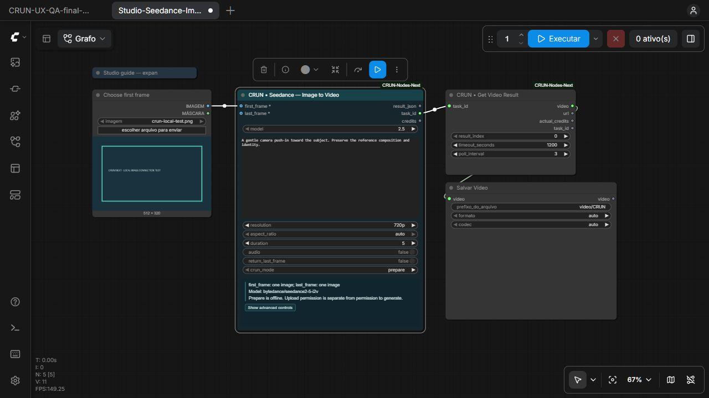

# CRUN Nodes Next

An independent **CRUN integration for ComfyUI**, by Felipe Silva. Built on the
lessons of [KIE Nodes Next](https://github.com/felipederosilva/ComfyUI-KIE-Nodes-Next),
with separate code, credentials, node IDs and installation. Not affiliated with
or endorsed by CRUN or Comfy Org.

## 0.3.0 — native references and model-family workflows

Connect **Load Image** to **Seedance — Image to Video**, choose a version from
its model dropdown, and work with that version's supported controls. CRUN Next
now provides 62 focused image/video family nodes covering 162 catalog operations,
with native image and mask connections where the reference roles are known.

The model selector updates choices, ranges and reference requirements. Advanced
URL/technical inputs stay behind **Show advanced controls**. Switching a model
resets execution to prepare and disarms upload/paid permissions for review.

Result nodes retrieve an existing task as native **IMAGE** or **VIDEO**, save a
local copy under `output/CRUNResults`, and connect to Comfy preview/save nodes.
The 62 Studio workflows illustrate the full graph and begin in offline prepare
mode. **No real provider upload, estimate, generation or generated-media download
was performed while developing 0.3.** See [VALIDATION.md](VALIDATION.md).

The bundled snapshot was collected on **25 October 2026**:

| Inventory | Bundled coverage |
| --- | --- |
| Model/operation definitions | 274 entries, including 273 exact wire model IDs across 21 providers |
| LLM definitions | 64 IDs in the documentation/live-discovery union: 55 listed by the authenticated check, 9 documentation-only |
| Individual AI Effects | 1,063 unique templates: Kling 226, ByteDance 341, Vidu 496 |
| Effects source records | 1,088 records; repeated template IDs share a node with retained variants |
| AI Tools | 18 documented tools, included in the model/operation definitions above |
| Recommended creative nodes | 62 model-family dropdown nodes covering 162 image/video operations |
| Studio workflows | 62 focused graphs with native references and result preview/save paths |
| Per-option catalog starters | 1,337, retained alongside the Studio workflows |
| Total starter workflows | 1,399, all in prepare mode |

These counts describe discovered definitions, not tested execution or access for
every CRUN account. Documentation-only LLMs are explicitly labeled as not listed
by the discovery check. LLMs and operations with dedicated protocols are
**prepare-only**. Simple documented image references accept native IMAGE/MASK
connections; advanced nested media and VIDEO/AUDIO input uploads remain pending.



## Install or update

Use the backend ComfyUI folder containing `main.py` and `custom_nodes`, not the
Desktop program/resources directory. Obtain source from this repository or an
available package from [Releases](https://github.com/felipederosilva/ComfyUI-CRUN-Nodes-Next/releases).

1. Close Comfy Desktop.
2. For an update, move the previous CRUN extension folder to a backup location
   **outside custom_nodes**. Comfy can import backups left inside that directory.
3. Extract into `ComfyUI/custom_nodes/ComfyUI-CRUN-Nodes-Next`, with
   `__init__.py` directly inside. Avoid an extra nested repository folder.
4. If needed, install `requirements.txt` with **Comfy's Python**. The package
   requires `requests`, `aiohttp`, `pillow` and `numpy`; Comfy supplies PyTorch.
5. Start Comfy and refresh the interface. Open **Settings → CRUN Next → Connection**.
   Use **Paste / replace CRUN API key**, **Save key**, then **Check connection**.
6. Open the **CRUN Next** launcher or **Extensions → CRUN Next** for **Models**,
   **AI Effects** and **AI Tools**. Search **CRUN** in the Nodes menu. Image and
   Video families are the recommended starting point; individual per-model nodes
   remain available under **Advanced → Catalog** for compatibility.

The four native settings rows expose key entry, a safe saved-key summary,
connection state and balance. Saved status is historical; use a live check to
confirm the current key/balance. Credentials live outside the extension package.

The optional helper is **first-install-only**:

```powershell
python scripts/install.py --custom-nodes "C:\path\to\ComfyUI\custom_nodes"
```

It requires the explicit backend path, refuses an existing destination, copies an
allowlist and verifies hashes. It does not install dependencies or start Comfy.

## Start with a Studio workflow

Open a `Studio-` workflow from [example_workflows](example_workflows) or Comfy's
workflow-template library. Select the model family and task first, then the model
version in its dropdown. Connect the labeled image references. When a socket
accepts an image batch, batch order is preserved. A native connection and its
advanced URL fallback cannot both supply the same field.

1. Keep `crun_mode=prepare`, `crun_allow_upload=false`,
   `crun_allow_paid_generation=false` and `crun_max_credits=0`. Run to inspect
   local reference metadata, the prepared request and validation errors. Prepare
   never uploads or contacts CRUN. Downstream result previews wait for a task ID.
2. Select `estimate` to request a quote without creating a job. With native
   references, explicitly enable `crun_allow_upload`: the images/masks must be
   sent to CRUN before its estimate can use their temporary URLs. Without that
   permission, estimation stops before uploading. Existing HTTPS URL references
   do not need a new upload.
3. Review the selected model, media, supported settings and quote. To submit,
   select `generate`, enable paid permission and set a positive credit ceiling.
   The node uploads only if separately permitted, gets an estimate, checks
   ceiling/balance and submits **once**. Uploads can therefore occur before a
   quote exceeds the ceiling. The ceiling is not a provider-enforced final cap.
4. Connect `task_id` to **Get Image Result** or **Get Video Result**. The result
   node polls that same ID, downloads a selected result, saves a durable local
   copy and returns native media for Preview/Save. A timeout does not resubmit;
   keep the ID and rerun retrieval for that task.

On timeout or an unknown submission outcome, inspect CRUN's task logs before
submitting again. There is no automatic retry. A local journal keeps submission
markers/task IDs without prompts, media URLs or keys. Disarm generation before
editing or sharing a workflow: another execution of an armed node can create
another paid job.

Reference roles/counts and controls follow the selected schema; unsupported
connections stay attached and produce a useful validation error instead of being
silently discarded. Some file limits, conditions and Effects slot meanings exist
only in provider prose. Review those instructions before a paid request.

Native uploads cover recognized simple image/reference fields and masks. Complex
nested face-swap/3D references still use structured JSON. Native VIDEO/AUDIO input
uploads and LLM execution are not implemented. Generated output quality and paid
end-to-end execution remain unverified.

## Credits and utility nodes

- **Connection Status** reads safe local configuration without contacting CRUN.
- **Credits** reads balance and prints it in Comfy's console.
- **Effects Catalog** reads one provider's live metadata for inspection.
- **Prepare Effect Plan (Draft)** prepares an offline payload.
- **Estimate Credits (No Generation)** requests a model/input quote.
- **Inspect Existing Task** reads status/cost without creating another job.
- **Get Image Result / Get Video Result** poll an existing ID and return native
  media saved under `output/CRUNResults`; they never create a replacement job.
- **AI Tools Catalog** lists the documented tools and input definitions; individual
  tool nodes exist under **CRUN Next → AI Tools**.

Read-only utility requests can repeat when queued. CRUN credits are separate from
KIE and Comfy credits. Task cost is reserved while pending/running and actual
after success/failed according to [CRUN's task contract](https://docs.crun.ai/models/common/get-task-info).
Missing cost is shown as unavailable, not zero. Shared balance changes are not
used to infer an individual task's actual cost.

## Catalog sources and refresh

Sources are CRUN's [documentation inventory](https://docs.crun.ai/llms.txt),
English model OpenAPI definitions, the [LLM documentation table](https://docs.crun.ai/models/llm-list)
and the documented [live LLM inventory](https://docs.crun.ai/models/llm/quickstart).
Exact IDs come from schemas/discovery, never marketing names or page slugs.
Endpoint, protocol, source and availability labels remain attached to entries.

The workspace refresh is an explicit action; opening the catalog does not
contact CRUN. Public definitions come from documentation without credentials.
When a configured key is used for live LLM discovery, the separate authenticated
GET reads inventory only and preserves its distinct availability labels.
The Effects template snapshot has its own read-only sync. Restart Comfy after a
catalog refresh to register changed node definitions. Caches are separate from
credentials; source errors remain visible.

Developer commands, from a source checkout:

```powershell
python scripts/sync_catalog.py
python scripts/sync_effects.py --comfy-root "C:\path\to\ComfyUI"
python scripts/build_templates.py
```

Public model sync does not itself query account availability. Effects sync uses
the locally configured key for catalog GETs. Never pass a secret on the command
line. Review source labels/counts before publishing regenerated metadata.

## Credentials and privacy

Create your own key at [CRUN API keys](https://crun.ai/user-api-key) and enter it
only in CRUN Next settings. It is sent to the local backend and is never saved in
workflow JSON, browser localStorage or persistent Comfy setting values.

Windows keys use **DPAPI for the current user**, without plaintext fallback.
Other platforms use an owner-readable file that is **not encrypted**.
`CRUN_API_KEY` overrides saved storage; removing a saved key does not unset it.
Configuration is in Comfy's user area or the platform user config directory.
`CRUN_NEXT_CONFIG_DIR` can select a separate location outside Git. Credentials,
connection receipts, catalog caches and task journal are separate files.

Upload receipts are reused only in a credential/content-scoped memory cache for
up to 30 minutes. CRUN documents its upload URLs as temporary
(one hour); do not treat those URLs as permanent storage. Upload URLs are not
persisted as a public cache. Saved workflow fields or node outputs can still
contain private media links: review them before sharing.

The bridge is **loopback-only**, intended for a trusted single-user installation.
DPAPI protects data at rest; another custom node or compromised same-user process
can still access secrets or submit requests. Optional external previews load on
user action and reveal the browser's IP to the media host. No third-party preview
files or proprietary Effects implementation is bundled. Treat workflows with
private media links as sensitive. See [SECURITY.md](SECURITY.md).

## Development and verification

```powershell
python -m unittest discover -s tests -v
node --test tests/*frontend*.mjs
python scripts/build_release.py
```

Read-only authenticated balance, LLM inventory and Effects discovery were
exercised. Offline tests/schema coverage do not prove paid generation or every
model's output quality. **No paid job, provider upload, live cost estimate or
generated-media round trip has been tested for 0.3.** [VALIDATION.md](VALIDATION.md)
records actual checks.
See [ROADMAP.md](ROADMAP.md) for next gates. Comfy Registry is not submitted.

MIT license. KIE Next remains independent; neither package imports, overwrites
or routes requests through the other. Remote models/templates remain subject
to CRUN's service terms, availability and charges.
