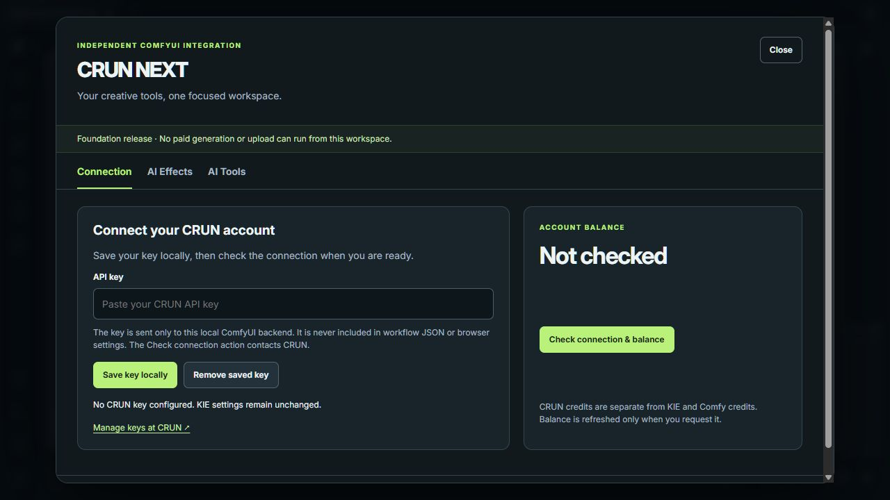

# CRUN Nodes Next

An independent **CRUN integration for ComfyUI**, by Felipe Silva. Built on the
lessons of [KIE Nodes Next](https://github.com/felipederosilva/ComfyUI-KIE-Nodes-Next),
with separate code, credentials, node IDs and installation. Not affiliated with or
endorsed by CRUN or Comfy Org.

## 0.1.0 — connection and discovery alpha

This is a working skeleton, **not an all-model generation pack**. You can configure
your own CRUN API key, check your balance and explore provider Effects catalogs.
No paid generation or file-upload endpoint is implemented in this release.



| Feature | 0.1.0 status |
| --- | --- |
| Comfy settings connection panel | Implemented; enter your key locally |
| Account balance | Implemented; explicit live check |
| Kling / ByteDance / Vidu Effects discovery | Implemented; requires your key; live catalog shape still needs account testing |
| Effects thumbnails / video previews | Opt-in only; no website assets bundled |
| Draft effect payload preparation | Implemented offline; **does not execute** |
| Task-cost estimate | Implemented; estimate endpoint does not create a job |
| Existing media task inspection | Implemented; distinguishes reserved from actual credits |
| AI Tools workspace | Researched roadmap cards with official documentation; **not executable yet** |
| Native IMAGE / VIDEO / AUDIO uploads and generation | Planned |
| All-model schema synchronization | Planned; no blanket support claim |
| Comfy Registry listing | Not submitted |

## Install in Comfy Desktop / local ComfyUI

Use the **actual backend ComfyUI folder** containing `main.py` and `custom_nodes`.
Do not install into the Desktop application's program/resources folder.

1. Close Comfy Desktop.
2. Download this repository or the tagged release ZIP. Extract the package into
   `ComfyUI/custom_nodes/ComfyUI-CRUN-Nodes-Next` (with `__init__.py` directly inside).
   Alternatively clone this repository into that location.
3. If dependencies are missing, install `requirements.txt` with **Comfy's Python**.
   This package uses `requests` and `aiohttp`; most current Comfy installs have them.
4. Start Comfy Desktop and refresh its interface.
5. Open **Settings → CRUN Next → Connection** and turn on
   **Open connection & creative workspace** (it opens the panel and resets itself).
   A **CRUN Next** launcher/menu action is also provided when supported.
6. Paste your key into the password field and choose **Save key**. Then use
   **Check connection** to make a read-only account-balance request.

The included `scripts/install.py` is an optional **first-install-only** helper:

```powershell
python scripts/install.py --custom-nodes "C:\path\to\ComfyUI\custom_nodes"
```

It requires the explicit backend path, refuses an existing destination, copies an
allowlist, verifies hashes, and does not install dependencies or start Comfy.

## Credentials and privacy

- Create your own key at [CRUN API keys](https://crun.ai/user-api-key).
- Keys are submitted only to the local Comfy backend, then used by that backend
  with CRUN. The credential is **not a graph widget** and is never written into
  workflow JSON, browser localStorage or persistent Comfy frontend settings.
- Windows: saved keys use **Windows DPAPI, current user**. They are not portable
  to another Windows account/machine. A DPAPI failure does not fall back to plaintext.
- Other systems: a local owner-readable file is used; this is **not encrypted**.
- `CRUN_API_KEY` overrides a saved key for headless use. Clearing a saved key does
  not unset the environment variable.
- Configuration is stored outside the extension/repository in Comfy's user area,
  or a platform-specific user config directory. `CRUN_NEXT_CONFIG_DIR` can select a
  dedicated test location. Never put that location in a Git repository.
- Connection-panel HTTP routes are intentionally **loopback-only** in this alpha;
  remote/shared Comfy deployments need a separate multi-user security design.
- Local plaintext HTTP, same-user malware and a compromised Comfy extension can
  still compromise credentials. DPAPI is at-rest protection, not a security sandbox.

## Nodes

Search **CRUN** in Comfy's node menu:

- **Connection Status**: local safe configuration summary.
- **Credits**: refresh the CRUN account balance; also prints it in Comfy's console.
- **Effects Catalog**: fetch one provider's live template metadata.
- **Prepare Effect Plan (Draft)**: prepare JSON from documented effect contracts.
- **Estimate Credits (No Generation)**: submit a model/input JSON to cost estimation.
- **Inspect Existing Task**: query a task ID without creating another generation.
- **AI Tools Roadmap**: list researched tools and documentation, not executable nodes.

These output nodes run when included in a queued graph. Read-only provider checks
may repeat; no node in 0.1.0 can create a paid task. Node descriptions label this.

Credits remain **CRUN credits**. They are not interchangeable with KIE or Comfy.
Task credits are reserved while pending/running and actual after success/failed,
according to [CRUN task documentation](https://docs.crun.ai/models/common/get-task-info).
Missing cost data is shown as unavailable, never silently reported as zero.

## Effects Studio and AI Tools

Instead of one identical node per model, this project's direction is:

- **Effects Studio**: visual discovery, named reference slots, provider-specific
  requirements and an explicit budget/confirmation step.
- **AI Tools Workbench**: focused image repair, inpainting, upscale and video
  enhancement workflows, with useful native Comfy inputs/outputs.
- **Credit clarity**: distinguish estimated, reserved, spent and remaining values.
- **Reusable recipes**: record chosen effects/tools and inputs without embedding keys.

Only the alpha features above exist today. See [ROADMAP.md](ROADMAP.md) and the
[provider research](docs/PROVIDER_RESEARCH.md) for verified API surfaces and unknowns.
No template previews, third-party website assets or proprietary effect code are
redistributed. Templates still execute on CRUN, subject to their terms and charges.

## Development and tests

```powershell
python -m unittest discover -s tests -v
node --test tests/frontend*.mjs
python scripts/build_release.py
```

Tests are offline with fake transport responses. A local Comfy import/UI smoke
test does not prove real CRUN authentication or generation. See
[VALIDATION.md](VALIDATION.md) for the release's actual verification status.

MIT license. Keep KIE Next installed alongside it if desired; neither package
imports, overwrites or automatically routes requests through the other.
